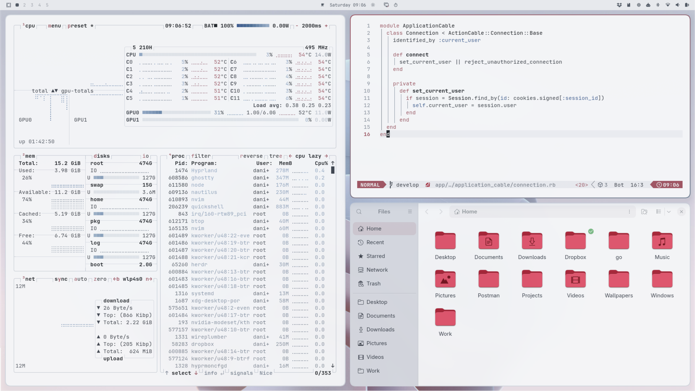

# Porcelain

A light theme for [Omarchy](https://omarchy.org): cool porcelain surfaces, a
graphite ink, and a single rose bounce light.



## Install

```bash
omarchy theme install https://github.com/daniel-felipe/omarchy-porcelain-theme
```

Or from the menu: `Super + Space` → _Install > Style > Theme_, and paste the
repo URL. Remove it again with _Remove > Theme_.

**For full fidelity, run a few more commands after installing:**

```bash
cd ~/.config/omarchy/themes/porcelain
rm -rf .git
cp hyprland.lua.example hyprland.lua
cp neovim.lua.example neovim.lua
omarchy theme set porcelain
```

Omarchy will not run `.lua` from a theme it cloned from a repo — a Hyprland or
Neovim config runs code at startup — so the repo ships them as
`hyprland.lua.example` and `neovim.lua.example`, and a fresh install falls back
to Omarchy's generated defaults for the border and for Neovim. Those generated
defaults are tuned for dark themes and get three things wrong on a light one
(see `neovim.lua.example`'s header comment for the exact bugs). Removing `.git`
turns the installed copy into an ordinary user theme, which Omarchy does not
restrict, so once copied to their real names both files take effect.
The tradeoff: `omarchy theme install` will no longer pull updates from this
repo into that directory. For a theme this opinionated about a light-mode
Neovim, that tradeoff is worth taking.

## The idea

The palette is derived from a set of wallpapers that are all one material
photographed under different light — a matte, sculpted ceramic surface, lit
bright, lit warm, lit dark. No hard edges, no texture, no visible seams. What
separates one plane from the next is a value step, never a line. (The
derivation set and what ships in `backgrounds/` differ slightly; see
*Wallpaper credits*.)

Sampling them turns up two chromatic events and nothing else:

- a **warm rose bounce light** at hue ~351 (`#FFC3CB` at its brightest)
- a **cool slate-teal ambient shadow** at hue ~170–200

Everything else is porcelain: `#FAFAFA` down through `#7B7D88` to `#050505`.

The theme keeps that ratio rather than spreading colour evenly.

| Role | Token | Value | Where it shows |
|---|---|---|---|
| Deepest ground | `darker_background` | `#d4d8df` | backdrop, inactive chrome, scrollbars |
| Plate | `dark_background` | `#e7e9ed` | bar, sidebars, editor gutter, GTK chrome |
| Working surface | `background` | `#f4f5f7` | terminal, editor body, app windows |
| Highlight band | `lighter_background` | `#eaecf0` | cursorline, current row, hover |
| Lifted card | — | `#ffffff` | launcher, menus, notifications, popovers |
| Reading text | `foreground` | `#3b424c` | body text |
| Emphasis | `bright_foreground` | `#1d2229` | headings, cursor, selected-row text |
| Secondary text | `light_foreground` | `#525a65` | bar labels, captions |
| Receding text | `dark_foreground` | `#68717d` | disabled, placeholders |
| Structure | `muted` | `#848e9b` | comments, line numbers, ANSI bright-black |
| Divider | — | `#d2d7de` | splits, table rules, list separators |
| Border | — | `#bcc3cc` | cards, inputs, chips, btop boxes, GTK widgets |
| **Rose** | `accent` | `#9e5462` | focus, selection, active border, folders, wordmark, keywords |
| Rose, alarm | `red` | `#a8394b` | errors, diff-removed, the top of the heat ramp |
| **Blue** | `blue` | `#4a6c94` | strings, info, activity, throughput, diff-added |

**Four surface steps, ~1.1:1 apart.** The bar sits *below* window surfaces and
floating cards sit *above* them, so depth is readable from value alone — which
is exactly how the wallpapers separate their planes. Cards go to pure white
rather than to `lighter_background`: on a light ground, "lifted" means brighter.
`lighter_background` is the cursorline band and sits below the working surface.

**Two hues. That is the whole palette.** Rose and blue; everything else is a
neutral grey. There is no third family anywhere — not in syntax, not in meters,
not in icons, not in status.

- **Rose** (`#9e5462`, hue 349) is *you*, and *alarm*. Focus, selection, the
  active window border, the cursor, the active tab, the mode block, folders,
  the wordmark, and keywords in code. Pushed to high chroma (`#a8394b`) the
  same family becomes the error state: more urgency, no new hue.
- **Blue** (`#4a6c94`, hue 212) is everything else that has to be seen.
  Strings, numbers, information, activity, throughput, diff-added.

The blue is not an arbitrary partner — it is **the ground amplified**. Every
neutral in this theme is already a desaturated blue: the surfaces measure hue
218–220, the ink 215, `muted` 214. Turning that same hue up to full chroma adds
nothing foreign, sits 137° from the rose, and can never be mistaken for green.

Earlier versions carried eight hues, then five. Both read as a collection of
separately themed applications rather than one system. **Two is what actually
holds together.** The rule that took three attempts to learn: *anything with
real area on screen is the rose or it is neutral* — never the second colour and
never a third, because a large block of any other hue reads instantly as a
competing primary. Folders went crimson → teal → sage before landing back on
the rose, and each intermediate step broke that rule a different way.

**Ink, not black.** Text is cool graphite (`#3b424c` / `#1d2229`), taken from
the shadow in the dark wallpaper. Pure black on near-white glares; graphite does
not. Body text runs 9.3:1 on the working surface.

**Syntax is collapsed to four categories.** With only two hues available, hue
can no longer label eight token types, so it labels categories and weight
carries the rest:

| | | |
|---|---|---|
| rose | grammar | keywords, control flow, imports |
| blue | data | strings, numbers, booleans, regex |
| ink, bold | names | functions and types you defined |
| ink | subjects | variables, properties, parameters |
| grey | noise | comments, punctuation, operators |

Reading code becomes *grammar / data / names / everything else*. Coarser than
eight hues, but consistent, and it survives being looked at next to the rest of
the desktop. Within a family the ANSI slots separate by **chroma, not
lightness** — on a near-white ground a "lighter blue" cannot be light enough to
look different and still clear 4.5:1, so all three blues sit at one darkness
and differ in saturation: 23, 33, 41. Every base colour clears 4.5:1 on
`background`.

Red/green diffs are the one convention this gives up: added is blue, removed is
the alarm rose.

`muted` is text, not a fill. It has to stay legible as comments and line
numbers, which pins it at 3.1:1. That makes it unusable as a selected-row
background, and the two constraints genuinely do not overlap: staying readable
as dim text on `background` needs L ≤ 0.29, carrying body ink as a fill needs
L ≥ 0.44. So the fill role moved off the token entirely — every selected row in
the system is the selection wash, which is also what ghostty uses for terminal
selection. A selected row in the editor and a selected range in the shell are
finally the same colour.

## What is in here

- `colors.toml` — the palette. Everything Omarchy templates (terminals, Helix,
  VS Code, Chromium, Obsidian, gum, Claude, Pi, keyboard RGB) is generated from
  it.
- `hyprland.lua.example` — gaps, rounding, shadow, blur, groupbar, and the
  border colours. Once installed as `hyprland.lua`, Omarchy skips generating
  one from `colors.toml`, so the borders are set here explicitly. On a near-white
  desktop a tight dark shadow reads as dirt, so the shadow is wide and faint.
  Only applies once `.git` is removed — see *Install*.
- `neovim.lua.example` — aether, with the palette plus the light-mode corrections
  aether's dark-theme defaults get wrong: cursorline, search wash, lualine mode
  block, and every "this row is chosen" highlight. See the comments in the
  file. Only applies once `.git` is removed — see *Install*.
- `shell.*.toml` — per-section overrides of the generated `shell.toml`. Only
  the sections that deviate from Omarchy's defaults are here, so upstream
  changes to the others still land. The important deviations are the lifted
  white cards and the scrims: Omarchy's default scrim is `background`, and a
  white wash over a white desktop focuses nothing, so the launcher, menu, and
  polkit scrims are ink instead.
- `btop.theme` — hand-written, because the stock template grooved every meter
  in the selection wash and ran a different multi-hue ramp per family, so btop
  used all eight palette hues at once. One hue per family now, deepening with
  magnitude; one hairline for all four boxes; the alarm rose only at the top of
  the temperature ramp. Activity is blue, inactivity is neutral, focus is rose.
  See the comments in the file.
- `icons.theme` — `Yaru-red`, whose folders measure `#DD5169`: hue 349, the
  accent's own. Folders are the highest-count object on the desktop, so
  whatever colour they take becomes a primary whether or not that was intended.
  The only safe answer is for that primary to be the one the theme already
  has. Two alternatives were tried and both failed: `Yaru-prussiangreen`
  (hue 179) and `Yaru-sage` (hue 131, 6% saturation) — and *both* read as green
  against these surfaces, because every grey here leans blue at hue 214, so
  even a nearly-achromatic green-grey separates from the ground as green.
  Saturation percentage is the wrong metric; hue direction relative to the
  ground is the right one.
- `backgrounds/` — three wallpapers from the same Windows 11 Bloom render
  family. `0-porcelain-bloom` leads the rotation: it is the brightest of the
  set and the only one carrying both chromatic events at once.
- `preview.png` — the theme switcher card.

## Extras (optional, not installed automatically)

Omarchy's theming does not reach GTK apps, lazygit, fastfetch, or your shell
prompt. `extras/` has the pieces that close those gaps on my setup. Copy what
you want:

| File | Goes to | What it does |
|---|---|---|
| `gtk-colors.hook` | `~/.config/omarchy/hooks/theme-set.d/` (`chmod +x`) | Regenerates `~/.config/gtk-{3,4}.0/gtk.css` on every theme change, so Nautilus and GTK dialogs leave stock Adwaita grey and blue behind. Maps chrome to `dark_background`, content to `background`, cards to a lifted surface chosen by the theme's `mode`. |
| `lazygit-colors.hook` | `~/.config/omarchy/hooks/theme-set.d/` (`chmod +x`) | Regenerates `~/.config/lazygit/config.yml`, replacing lazygit's default green borders and blue selection bar. |
| `fastfetch-logo.hook` | `~/.config/omarchy/hooks/theme-set.d/` (`chmod +x`) | Rewrites the logo colour in `~/.config/fastfetch/config.jsonc` to the current theme's `accent`. Omarchy ships the wordmark on ANSI `green`, i.e. the *success* colour, and it is the largest block of colour on screen when fastfetch runs. No ANSI slot holds the accent, so this writes a truecolor escape and re-writes it on every theme set. |
| `starship.toml` | `~/.config/starship.toml` | Prompt. Theme-agnostic — uses ANSI colour names rather than hex, so it follows whichever theme is current rather than pinning this one. |

All three hooks are **theme-agnostic**: each reads whatever theme is current,
so they keep working after you switch away from Porcelain.

GTK and lazygit both read their config at application start, so relaunch them
after the first theme change.

Two things Omarchy generates but does not switch on by itself:

- **Claude Code.** `omarchy-theme-set-claude` writes `~/.claude/themes/omarchy.json`
  on every theme set, but only points `~/.claude/settings.json` at it when run
  with `--activate`. Without that the app stays on its built-in light theme —
  a `#5A6AF7` indigo at 91% saturation, against this palette's most saturated
  colour at 57%. Run it once: `omarchy-theme-set-claude --activate`.
- **The Omarchy banner.** `omarchy-show-logo` hardcodes `\033[32m`, so the
  wordmark renders in ANSI green — which this palette defines as *success*,
  making the largest colour mass on screen a semantic that is not reporting
  anything. fastfetch had the same problem and is fixed by
  `fastfetch-logo.hook` above, which puts the wordmark on the accent. The
  banner needs a root edit of a pacman-owned file, so it is left alone; see
  *The one thing not applied* below.

## Editing

Change `colors.toml`, then:

```bash
omarchy theme set porcelain
```

## Wallpaper credits

The wallpapers are not mine and are included only so the theme ships with
backgrounds that match it. They are the work of their respective artists, via
[wallhaven](https://wallhaven.cc): `wallhaven-g7ow5e`, `wallhaven-kxpd5d`, and
`wallhaven-7jwp69`.

The palette was derived from `kxpd5d`, `7jwp69`, and `e8xlgw` (a near-black
variant, left out of the rotation because a black desktop under a white bar and
white cards is the one cohesion break this theme cannot absorb). `g7ow5e` was
added afterwards and measured against the finished palette rather than feeding
it: its shadow rose sits at hue 341 against the accent's 349, and its highlight
at hue 188 against `cyan`'s 190.

If you are the artist and would rather not be included here, open an issue and
I will remove the image.

## The one thing not applied

`/usr/share/omarchy/bin/omarchy-show-logo` prints the wordmark in ANSI green:

```bash
echo -e "\033[32m"    # ANSI 32 -> palette slot 2 -> green, i.e. "success"
```

Changing the `32` to `35` moves it to magenta, which sits on the rose side of
the palette and stops the desktop's largest colour mass from meaning "success".

It is left unapplied on purpose. The file belongs to the `omarchy-dev` package,
so the edit needs root, and a package upgrade will silently revert it. That is a
decision about a system file rather than about this theme:

```bash
sudo sed -i 's/033\[32m/033[35m/' /usr/share/omarchy/bin/omarchy-show-logo
```

## License

The theme files (`colors.toml`, `hyprland.lua.example`, `neovim.lua.example`,
`btop.theme`, `shell.*.toml`, `icons.theme`, `extras/`) are MIT — see
[LICENSE](LICENSE).
The wallpapers in `backgrounds/` and the screenshot in `preview.png` are
excluded from that grant and remain the property of their respective artists.
